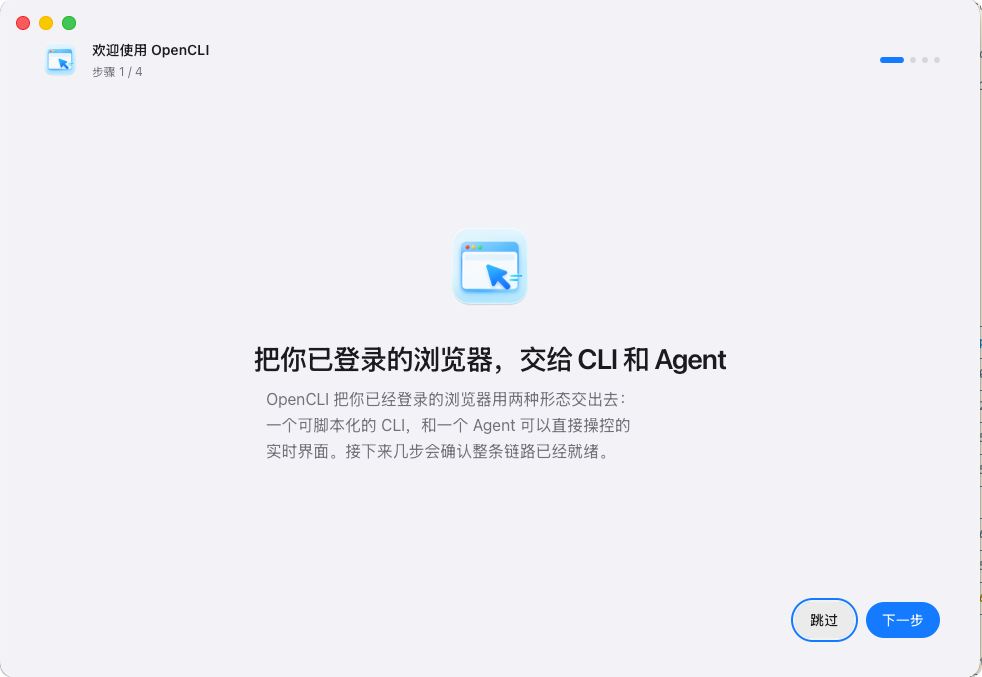
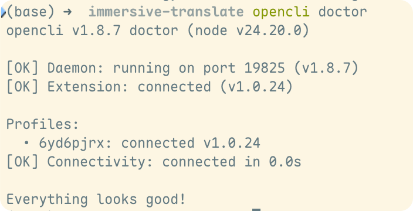
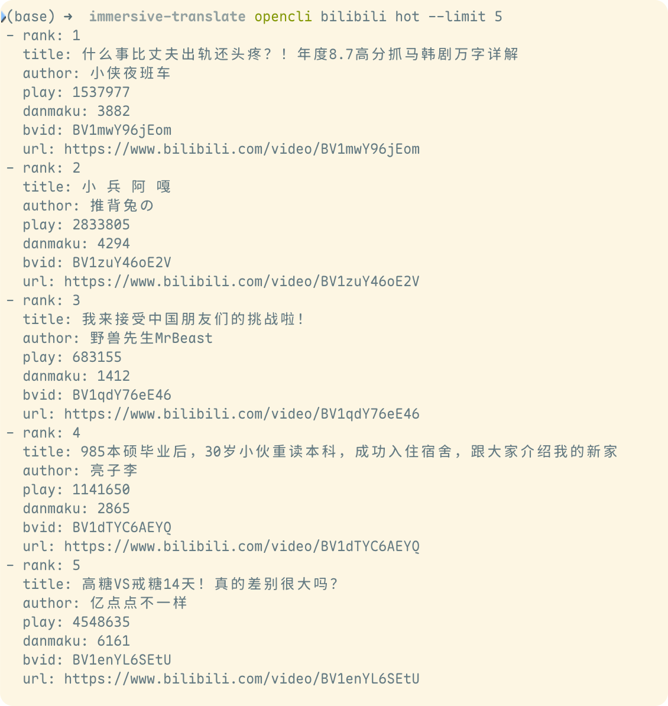
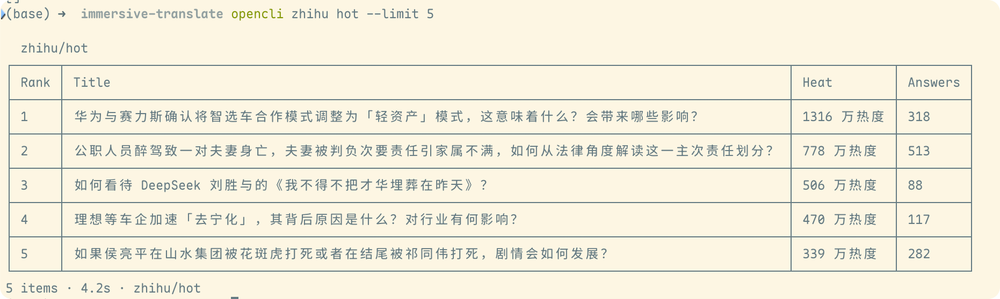
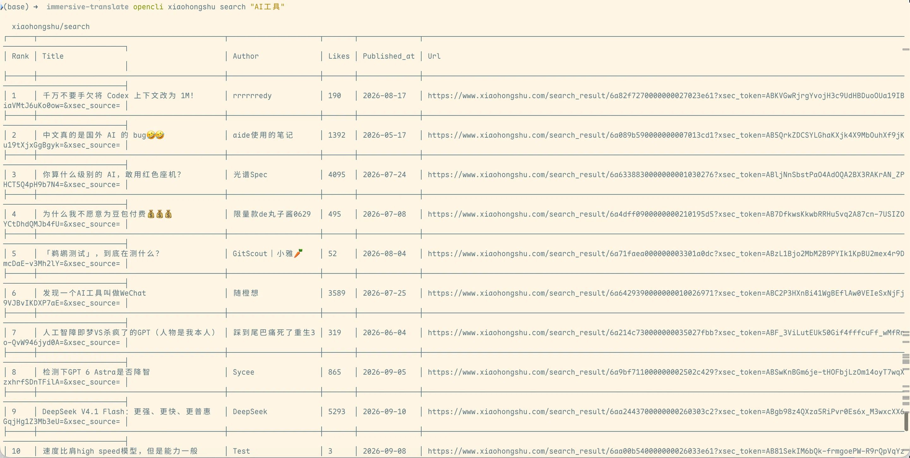

# GPT-6 都能自己点鼠标了，我为什么还在折腾命令行

9 月 4 号，GPT-6 Astra 发布，主打的卖点是 Computer Use：模型自己开浏览器、看屏幕、点按钮、填表单，官方演示里它甚至能用 KiCad 画电路板。按这个势头，「让 Agent 操作软件」这个问题似乎已经要被暴力解决了。反正它能像人一样点 GUI，还要什么接口？

但我这个下午，却花在了一个命令行工具上。

这个工具叫 OpenCLI，在 GitHub 上已经攒了 2.9 万颗星。它干的事情一句话能说完：把网站和 Electron 桌面应用变成命令行工具，复用你浏览器里已经登录的账号。我本来只是想装来看看，结果一个下午折腾下来，踩了坑，也开了眼，还想明白了一些 GPT-6 语境下才看得清的问题。这篇就是我的实测记录和判断。

先说结论：**Computer Use 和 CLI 不是谁取代谁的关系。GUI 操作是 Agent 的兜底能力，CLI 这类结构化接口才是它的母语。** OpenCLI 的价值不在于支持了多少站点，而在于它示范了「软件的接口层」应该怎么为 Agent 重做一遍。


## 它到底是什么

OpenCLI 是一个命令，但底下是四种工作模式。

日常最常用的是网站适配器：把 B 站、知乎、小红书、微博、抖音、豆瓣这些站点包成命令，比如 `opencli zhihu hot` 拉知乎热榜，官方称已覆盖 100 多个站点，雪球、BOSS 直聘、微信读书、小宇宙都在列表里。给 AI Agent 用的是浏览器原语，也就是导航、点击、填表、提取这套底层命令，Agent 装上对应的 skill 后可以直接驱动你本机的 Chrome。桌面方向是 Electron 适配器，通过 Chrome DevTools Protocol（CDP）操作桌面应用，内置了 Cursor、ChatGPT 桌面端、豆包、Trae 等 10 个。最后还有一个 CLI hub，把你本地已有的命令行工具（gh、docker、obsidian 等）登记进同一个入口，统一从 `opencli <工具名>` 调用。

技术上的实现流程是：CLI 命令 → 本地 Daemon（监听 localhost:19825，空闲自动退出）→ WebSocket → Chrome 扩展 → 网页操作。关键是它复用你 Chrome 里的登录态，凭据不离开浏览器。

摸清这四层之后，我对它的定位有了一个自己的讲法：**OpenCLI 是标准化层，不是穿透层。** 它调用的网站 API、Electron 的 CDP 调试协议，这些门本来就在那里，谁都能推。OpenCLI 做的是把这些散落的、各自为政的接口，统一包成 Agent 能发现、能组合、确定性执行的命令。`opencli list` 一下，所有能力在一张清单上。它对每扇门的态度是顺势而为：有官方接口就用官方接口，没有才自己造。

顺带一提，同样在做「给软件装 CLI」的还有 CLI-Anything，它从源码出发，给 GIMP、Blender 这类开源软件逆向生成 CLI。一个从浏览器进，一个从源码进，思路不同，方向一致。

## 我装了一遍

这部分是一个下午的实测流水，但我觉得比任何功能列表都说明问题。

先说安装。macOS 上装 OpenCLIApp 桌面端，应用内一键装好 `opencli` 命令，再去 Chrome 商店装个扩展。装完打开应用，欢迎向导第一页写着一句话：「把你已登录的浏览器，交给 CLI 和 Agent」。它自己的产品定义和我上面说的几乎是同一句话。



跑 `opencli doctor` 自检，四项一次全绿：

```bash
$ opencli doctor
opencli v1.8.7 doctor (node v24.20.0)

[OK] Daemon: running on port 19825 (v1.8.7)
[OK] Extension: connected (v1.0.24)
[OK] Connectivity: connected in 0.0s

Everything looks good!
```



对比很多 Agent 工具的配置地狱，这个过程顺得有点意外。

先试 B 站。`opencli bilibili hot --limit 5`，直接返回结构化数据：

```yaml
- rank: 1
  title: 什么事比丈夫出轨还头疼？！年度8.7高分抓马韩剧万字详解
  author: 小侠夜班车
  play: 1537977
  danmaku: 3882
  bvid: BV1mwY96jEom
- rank: 2
  title: 小 兵 阿 嘎
  play: 2833805
# ...共 5 条
```



B 站热门是公开接口，不需要登录。所有命令的输出都支持 table/json/yaml/md/csv 五种格式，json 可以直接 pipe 给别的程序。

知乎这一站，翻车了。`opencli zhihu hot` 返回 `[]`，一个空数组。开 verbose 模式看管线，卡在哪一步看得清清楚楚：

```bash
$ opencli zhihu hot -v
  [1/4] navigate → https://www.zhihu.com   → (no data)
  [2/4] evaluate → fetch 热榜 API           → 0 items   # 卡在这里
  [3/4] map (rank, title, heat, url)        → 0 items
  [4/4] limit                               → 0 items
⚠  Command returned an empty result.
```

导航正常，是页内请求知乎热榜 API 返回了 0 条，未登录状态下知乎直接不给数据。我在 Chrome 里登录知乎后重跑，4.2 秒，五条热榜带着热度值和回答数回来了：

```bash
$ opencli zhihu hot --limit 5
1  华为与赛力斯确认将智选车合作模式调整为「轻资产」模式…  1316 万热度  318 回答
2  公职人员醉驾致一对夫妻身亡…主责划分？                778 万热度   513 回答
3  如何看待 DeepSeek 刘胜与的《我不得不把才华埋葬在昨天》？ 506 万热度    88 回答
5 items · 4.2s · zhihu/hot
```



这次翻车比前面的顺利更有价值。它让我直观理解了「复用登录态」划出的能力边界：Agent 能干什么，取决于你在浏览器里是谁。同时还暴露了一个隐患：**没登录时它不报错，直接静默返回空。** 人看到空数组会想到「哦，可能没登录」，但 Agent 分不清「没数据」和「没权限」，可能拿着空结果继续做下游决策。

然后是小红书。`opencli xiaohongshu search "AI工具"`，一次成功：

```bash
$ opencli xiaohongshu search "AI工具"
1  千万不要手欠将 Codex 上下文改为 1M!     rrrrrredy      190 赞  2026-08-17
2  中文真的是国外 AI 的 bug🤣            aide使用的笔记   1392 赞  2026-05-17
8  检测下GPT 6 Astra是否降智              Sycee          865 赞  2026-09-05
9  DeepSeek V4.1 Flash：更强、更快、更普惠   DeepSeek官方   5293 赞  2026-09-10
# ...共 10+ 条
```



全程没有任何登录提醒。我 Chrome 里本来就保持着小红书的登录态，它直接拿去用了。对比知乎的「先吃闭门羹」，小红书是「无感通过」。那一刻的感觉很微妙：**它已经拿着我的身份在工作了，而我甚至没有被提醒一下。**

最后一项测试给了 Electron 应用。官方内置的 10 个桌面适配器里没有我顺手的，我干脆试了试官方文档里「给新 Electron 应用点亮」的标准流程。先测飞书，没走通。它的壳被字节深度定制过（包名 Lark、主程序叫 Feishu、框架改名 Lark Framework），调试端口没按预期打开。然后换 Obsidian：退出，加一个启动参数重新启动：

```bash
"/Applications/Obsidian.app/Contents/MacOS/Obsidian" --remote-debugging-port=9251
# 启动日志里出现：
# DevTools listening on ws://127.0.0.1:9251/devtools/browser/b0463bae-...
```

端口通了。我用 curl 直连这个 CDP 端点（注意，这一步不经过 OpenCLI，CDP 是 Electron 自带的调试协议）：

```bash
$ curl http://127.0.0.1:9251/json/version
{ "Browser": "Chrome/132.0.6834.210", ... "Electron/34.3.0" }

$ curl http://127.0.0.1:9251/json/list
标题: 15 - GeRenZiLiao - Obsidian 1.13.7   # 我的 vault 名和当前笔记标题
```

没有装插件，没有改配置，官方适配器列表里根本没有 Obsidian。只是一个启动参数，Agent 就看见了我的第二大脑。

这里我自觉只读了窗口标题级别的信息，没碰笔记内容。「能看见什么」和「该看什么」是两回事，这个分界后面还要讲。

还有一个计划外的发现：Obsidian 从 1.12 开始，官方自己就内置了 CLI，口号是「在 Obsidian 里能做的任何事，都可以通过命令行完成」，还专门给 AI 编码工具准备了开发者命令。**连应用厂商自己都开始给 Agent 装把手了。** OpenCLI 是从外面包，Obsidian 是从里面开，这个趋势是双向的。

## 真正重要的点

实测完回到开头的问题：GPT-6 都能直接点鼠标了，CLI 这条路还有意义吗？

我的判断是，有，而且 GPT-6 的数据自己就能说明为什么。看三个数字：Astra 在 OSWorld 2.0 电脑操作基准上得分 72.6%，平均每个任务耗时约 40 分钟，API 输入定价每百万 tokens 10 美元（上一代的 2.5 倍）。

翻译一下：**它每做四个任务大约错一个，每个任务要对着屏幕看 40 分钟，还很贵。** 看屏幕、理解布局、模拟点击，这是 Agent 的兜底能力，没有别的路时它能走通，但慢、贵、不确定性会随任务链长度复利叠加。而 `opencli zhihu hot` 是 4.2 秒返回结构化数据，确定性，可以进脚本、可以组合、可以 pipe 给下一个程序。

所以这件事准确的讲法是：高频的、要进工作流的任务，最终都会沉淀到结构化接口上；GUI 操作留给那些没有接口的长尾场景。两条腿都会存在，但承担的角色完全不同。

OpenCLI 里最能说明这个方向的地方，要数它给 Agent 准备的「自己写适配器」的能力，内置的 100 多个站点反而次要。对着一个陌生网站，Agent 可以侦察它的接口、生成适配器、验证可用。也就是说，**从「人给 Agent 写工具」变成了「Agent 自己长出手」。** 内置适配器的数量会过时，这个能力不会。

## 边界与风险

夸完必须说风险，这部分我花的时间不比实测少。

先说它覆盖不了什么。网站和 Electron 之外，原生桌面应用（比如微信桌面版）、Qt 系应用（WPS、Telegram 桌面版）、移动端 App，都在射程外，那些地方目前只能靠 Computer Use 兜底。另外有些参考文章把微信列为 OpenCLI 支持的 Electron 应用，这个说法有误，微信桌面版是原生应用，别照抄。

再说封号，这是我最想提醒的。OpenCLI 复用的是你的登录态，意味着平台风控眼里「操作者就是你」。查了下同类工具的教训：GitHub 上 60K star 的 MediaCrawler，issue 区有小红书账号被永久封禁的案例，作者的回应是「风控问题不处理」。风险大致按行为分级：低频只读（拉热榜、偶尔搜索）风险低；批量抓取风险中高；写操作（OpenCLI 支持 `xiaohongshu publish`、`zhihu answer` 这类命令）风险最高，自动化发布互动正是营销号检测的核心特征。平台之间的风控梯度大致是：小红书公认偏严，抖音其次，知乎微博再次，B 站相对宽松。

这里有个反直觉的对比。单论封号，**GPT-6 那类厂商 Agent 反而更安全。** Atlas 有「登出模式」，Agent 可以不用你的任何账号干活，平台要封封的是厂商的 Agent；就算登录了，OpenAI 还公开邀请网站加 ARIA 标签配合自家 Agent，平台对面站着的是厂商，不是你。而用 OpenCLI，平台对面站着的只有你。封号这件事的本质是平台对账号主体的惩罚，OpenCLI 让账号主体永远是你。

要说明白，Computer Use 那边「没有大规模个人封号报告」是「未见」而非「没有」，这条路太新，平台的处罚口径还没形成。它的核心风险在另一个地方：提示词注入。Anthropic 官方数据，浏览器 Agent 被网页里隐藏的恶意指令攻击的成功率是 23.6%，加了缓解措施后还有 11.2%。网页里人看不见的藏指令，只有 Agent 看得见。两种路线的风险人格完全不同：Computer Use 要防的是「模型做错事」，OpenCLI 要防的是「它做得太顺，你忘了它正以你的名义在行动」。

最后还有一个细节：OpenCLI 官方 README 对封号风险只字未提。这个沉默本身值得你记住。

## 我的判断

**这个方向我会持续跟，但现阶段只浅用。** 「CLI 重新成为 Agent 的通用接口」不是一句口号。Obsidian 官方 CLI 化说明厂商端也在动，这个趋势比 OpenCLI 单个项目更值得关注。

给想上手的人三条实操建议：

1. **主力账号只做低频只读**。拉热榜、搜资料这类用法风险可控；别挂定时任务批量跑，那正是风控画像。
2. **写操作换小号**。`publish`、`answer`、`comment` 这类命令想体验可以，别拿主力账号试。
3. **把 OpenCLI 接进 Agent 工作流之前，先想清楚权限边界**。它默认拥有你在浏览器里的一切权限，包括每一个保持登录的网站。

适合谁：已经在用 Claude Code、Cursor 这类 Agent 工具，想让 Agent 的能力半径扩展到网页和桌面应用的人。不适合谁：指望 7×24 无人值守自动化的人。技术上行，账号上行不通。

回头看我这个下午：装了一个工具，翻车一次，给自己的笔记库点亮了，顺带想清楚了 GPT-6 时代 CLI 的位置。工具会不会火我不确定，但「软件正在主动变成 Agent 可调用的样子」这件事，值得每个做 Agent 工作流的人多看一眼。

你现在的 Agent 工作流里，哪一步还在靠人肉复制粘贴？评论区聊聊。

---

> 参考资料：OpenCLI GitHub 仓库与官方文档、OpenAI GPT-6 Astra 发布说明及公开研报、Anthropic 官方博客、Obsidian 官方 CLI 文档。文中数据以 2026 年 9 月公开信息为准，关键数字建议回原始出处核对。
