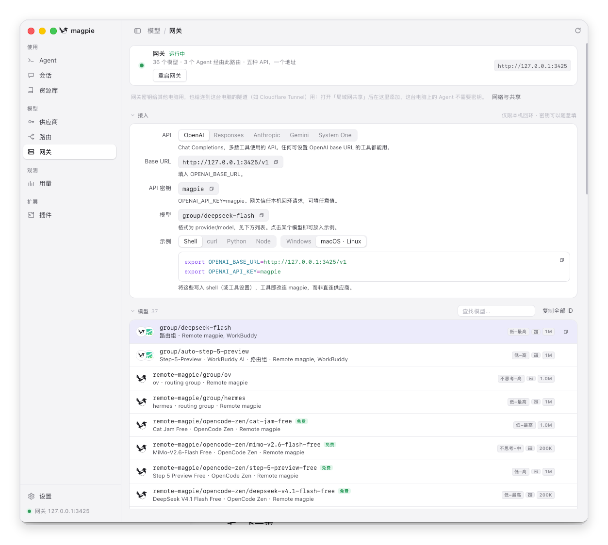
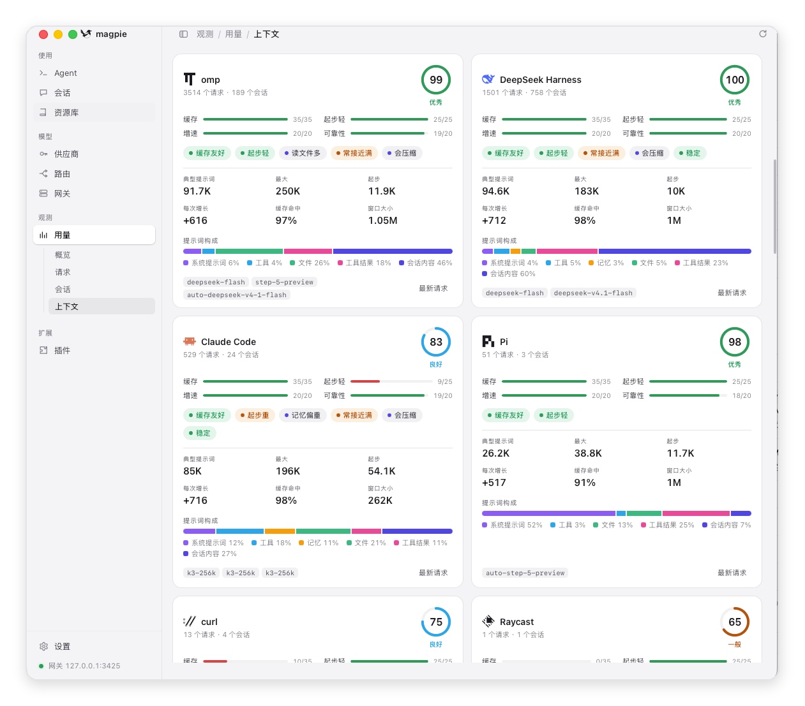
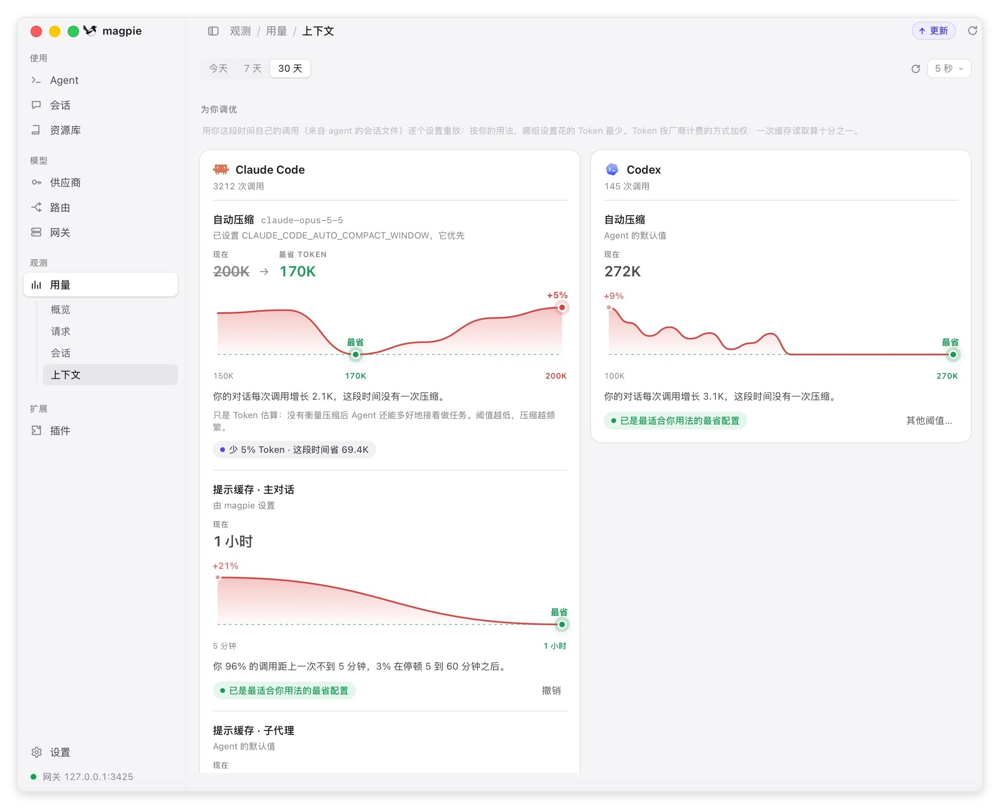
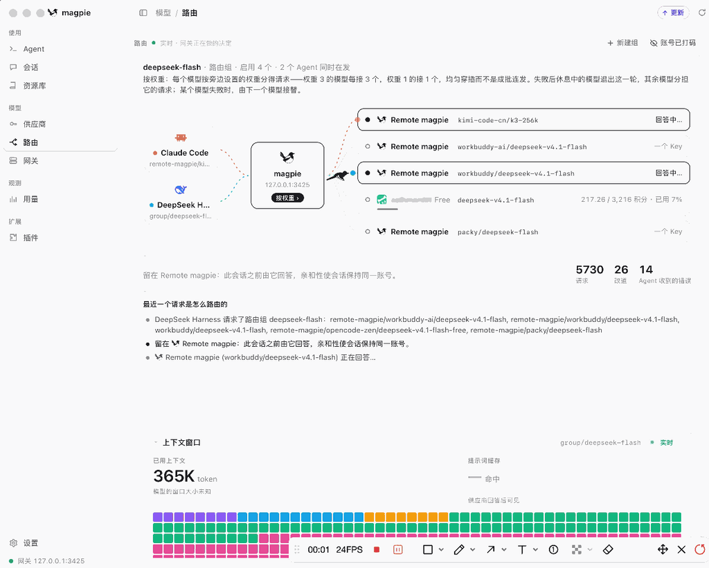

前段时间，我新买一台 Mac Mini 放在公司常年开着，原本的 MacBook 则可以随身带。

Mini 刚到手的时候，我都是让 hermes 把 MacBook 上相关的 Agent、LLM 一个一个同步到 Mini 上。这两台机器成了各养一套 key，各配一套模型，时间久了，一旦有模型要修改，得在两边分别改配置文件。而现在 MacBook 上的 provider 列表里，主要放了一个 `remote-magpie`。

这段时间两台机器每天合计跑几千到上万次调用，缓存读按亿级算，期间没有出现过网关不可用的情况。

这些数字打开界面就能看到，以前我不知道，因为根本没有一个地方会把它们摆到我面前。这也是我写这篇的原因。网上关于 magpie 的文章已经很多了，绝大多数在讲它能帮你省多少钱、怎么把额度用满。我这个用法不一样，我把它当成了一套基础设施在跑。

## 它既是一个入口，也是一块仪表盘

先用一句话说清 magpie 是什么：它是一个本地网关。

切换器的做法是改配置文件：你把某个 Agent 的 base URL 指向某个厂商，换模型就再改一次。网关的做法是在中间加一层转发，所有 Agent 都只认这一个地址，后面接谁由网关决定。

这也是为什么以前那套「让 hermes 同步配置」的办法会失效。同步的是一份快照，改一次就得同步一次，两份配置迟早会分叉。

项目 2026 年 9 月 23 日开源，MIT，Go 写的，到 10 月 19 日已经 16,500 多星。

我自己很早就用过 CC Switch，那时候它的功能还满足不了我的需求，所以卸载了。这次装上 magpie，是我需要的东西已经变了。我要的是这些 Agent 能不能共用一个入口，切换方便只是顺带的结果。

装完之后的拓扑是这样：

```
MacBook Air
  └─ provider: remote-magpie → http://magpie.open/v1
       └─ /etc/hosts 里解析到 127.0.0.1

Mac Mini（公司那台）
  └─ Gateway 监听 *:3425
  └─ lan: true
  └─ allowIPs: ["10.0.0.0/24", "192.168.99.0/24"]
  └─ caller-keys: 两个客户端，各有一把钥匙
```

真正的 key、真正的订阅登录，全在 Mini 上。Air 只是个客户端，它自己一个 key 都不养。

这个结构最实际的好处，是**一台常开的机器替你守额度、替你做减法**。所谓"多台机器共享模型"听着挺爽，真正省下来的其实是每天那几次翻找和配置。时间久了你会发现，真正麻烦的是改之前要先想起来该改哪个，改配置这一步反而最快。

Mini 上开着 `keepAwake`，它不会睡眠。MacBook 出门在外，只要连回那条隧道，模型列表和额度就跟上一次打开时一样。你要做的只是选模型，别的事那台机器替你想了。

但入口只是它的一半。另一半是：我现在随时能看见每一个 Agent、每一个 provider 各自用了多少。哪个 Agent 是真在干活、哪个 provider 被我晾着、某个订阅还剩多少额度，都在同一个面板里。以前这些信息散在四五家厂商后台，看一遍得来回切好几个页面。



## Mini 那台是怎么配的

`lan: true` 打开局域网共享。这一项不开，其他设备根本连不上来。

`allowIPs` 我设了两个网段：`10.0.0.0/24` 是自建的 WireGuard 隧道，`192.168.99.0/24` 是两台 Mac 之间的雷雳桥接。都是私有网络，公网打不进来。这两条线才是我放心的底气。


这里有个容易忽略的点：magpie 监听的是 `*:3425`，所有网卡都在听，普通的 Wi-Fi 网口也算在内。真正拦住请求的是白名单，**端口开着，请求进不来**。`allowIPs` 在这里是唯一防线，必须配。你不配，同一个网段里的人都能打进来。

`caller-keys` 我给两个客户端各发了一把钥匙，一个给另一台 magpie，一个给本地的知识库服务。分开的好处是哪个客户端出了问题，我直接把那一把吊销，另一个照跑。

还有一项 `gatewayConversations`，我开了。它会把经过网关的会话记下来，方便回看。这个看个人习惯，不需要就别开，能少一份数据落在盘上。

## 数据长这样

两台机器的用量，在 magpie 的用量面板里一页就能看完。下面是 10 月 18 日这一天的数字。

| 指标 | MacBook Air | Mac Mini |
|---|---|---|
| 单日调用（10 月 18 日全天） | 5,672 次 | 5,526 次 |
| 缓存命中率 | 98.0% | 97.7% |
| 请求成功率 | 99.8% | 99.4% |



这里我想多说一句缓存命中率。**我没有做任何优化，就是按默认配置跑的。** 高命中率是结构带来的：同一个 Agent 的会话一直粘在同一个模型上，厂商那边的前缀缓存就一直有效。

换句话说，magpie 其实没替我做过什么优化，它只是让我看见了一件原本就在发生、只是我看不见的事。在这之前，我根本不知道自己的缓存命中率是多少，因为没有一个地方会把这个数字摆出来给我看。

而且它不只让你看见过去。用量页里有个「为你调优」，会拿你这段时间真实的调用记录，把每个设置逐个重放一遍，算出哪一档最省 Token。

比如我这台机器上，Claude Code 的自动压缩当时是 200K，它算下来 170K 最省，能少 5%；提示缓存给到 1 小时也是最省的，因为我 96% 的调用都发生在距上一次不到 5 分钟。Codex 那边就直接给了「已是最适合你用法的最省配置」，因为这个 Agent 的调用方式本来就没那么多可调的。



前面那个 96% 是调优之前的数据，这些建议我是后来才采纳的。省下来的那几个 token 倒在其次，真正有用的是它顺带把一个我平常不会去算的问题摆出来了：我的提示词、skill、工具链有没有堆得太厚，上下文里有多少是白占着的。以前这类事只能靠感觉，现在有数可以对着看。

## 一个组，几个来源，按权重分活

我在 Air 上配了一个五个成员的路由组：

```
deepseek-flash   路由方式：按权重   5 个成员
  - remote-magpie/workbuddy-ai/deepseek-v4.1-flash   权重 5
  - remote-magpie/workbuddy/deepseek-v4.1-flash      权重 4
  - workbuddy/deepseek-v4.1-flash                    权重 3
  - remote-magpie/opencode-zen/deepseek-v4.1-flash-free  权重 2
  - remote-magpie/packy/deepseek-flash                     未设权重
```

我选的是「按权重」。路由组一共给了七种策略，界面上是这么排的：

| 策略 | 怎么分 |
|---|---|
| 智能（默认） | 在有余额的订阅里，优先用最快重置的那个 |
| 按顺序 | 用第一个，直到它答不了再换下一个 |
| 轮流 | 每轮对话交给下一个成员 |
| 最少使用 | 用额度和 key 里剩得最多的那个 |
| 重置前用完 | 按每小时剩余额度排，先把接近重置的用掉 |
| 按权重 | 每个模型按设定的权重分活，权重 3 的接 3 个，权重 1 的接 1 个，穿插着来 |
| 手动 | 只用你指定的那一个，其余的不参与，也不做失败转移 |

我选「按权重」，因为这几个来源的额度性质不一样，想让主力多接一点。至于「智能」，它按额度算着用，等于把决定权交出去；每个来源的情况我自己清楚，不需要它替我判断。

还有一层是「会话保持」，默认是自动：只要上游的缓存还值得保，这段对话就留在回答过它的那个账号上。我这组设成了固定整个会话，所以聊起来之后不会来回跳。

三天下来，这个组把活分到了四个来源上。同样是 Air 这台机器上的 `deepseek-v4.1-flash`，每天落在哪个来源上，数字是这样的：

| 日期 | workbuddy-ai（5） | workbuddy（4） | 本地直连（3） | opencode-zen（2） |
|---|---|---|---|---|
| 10-16 | 373 | — | 481 | — |
| 10-17 | 994 | 421 | 153 | 633 |
| 10-18 | 1,238 | 2,960 | 629 | — |

请求日志里留下了真实触发的记录：10 月 16 日 17:19 撞上一次 429 限流，10 月 18 日 10:55 连着四次 502，几秒一次，那是重试的节奏。这两次挂掉的其实是 `step-5-preview` 和 `k3-256k`，不是上面那个 `deepseek-v4.1-flash`。这也正是网关该干的事：某个模型或某个账号出问题，其他组照常跑，你根本不会察觉。



注意中间那行小字："留在 Remote magpie：此会话之前它回答过，亲和性使会话保持同一账号"。网关明明有好几个成员可选，它却主动留在了上次那个。这就是前面那个高缓存命中率的来源——它在替我省钱，只是从来不吭声。

**不让你看见报错，是它该做的事。但你最好知道它替你扛了什么。**

## 给想这么装的人

先说谁不需要它。README 里写得很直白：如果你只用单个 Agent、单个订阅，那其实不需要 magpie。这话我认同，别为了一个"看起来很酷"的网关去改一堆配置。

如果你确实有两台以上的机器，我建议分两步走：

先在**一台机器上**跑一个星期。搞清楚自己哪个 Agent 用哪个模型，再动局域网这一层。一上来就配白名单和 caller key，出了问题你会分不清是网络还是配置。

一个星期之后再打开 `lan: true`。`allowIPs` 一定要配，别嫌麻烦。

如果你那台常开的机器没有桌面环境（比如一台 Linux 服务器，或者只能 SSH 进去的机器），也一样能用。magpie 除了菜单栏、窗口、TUI 和 CLI，还有一个 Web 界面：`magpie web` 把整个应用搬到浏览器里打开，官方文档里写的就是给 WSL 和 SSH 到服务器这两种场景准备的。我这边两台都是 Mac，没用上这条路，写出来是给同样想架一台常开机器的读者一个参照。

## 有一件事得先说明白

这套东西好用，但它站在一个各厂商都没明说的位置上，风险得自己认。

作者本人被问到「这样算不算反代，会不会封号」时，回的原话是：请求是你本机真实的 Claude Code 发出的，magpie 不伪造 Claude Code。**但会不会封号由厂商的规则决定，没法打包票；把账号共享给别人用本身就违反条款。**

这两句是分开的，别混在一起读。前半句说的是技术实现：它走的确实是你自己的客户端，用的就是你本机那个真实的 CLI。这也是它比一些模拟指纹的中转工具更干净的地方。后半句说的是**规则解释权在厂商手里**，技术上再合规，也不等于对方一定认可。

说到共享，这一条最容易踩。我这两台机器、几个客户端，全是我一个人的设备，不存在把账号分给别人用的情况。拼车合租、拿一个订阅喂给一堆人，那才是条款里明写违规的那类用法，风险性质和自用完全不一样。

既然还是可能封，那这套折腾图什么？我的看法是：这个风险换成任何方案都存在，差别在于你知不知道自己踩在哪条线上。

## 结尾

回头看这几天，magpie 对我最大的改变，是换模型这件事我基本不用再想它了。

更实在的是，**我第一次知道自己到底用了多少**。哪台机器在跑、哪个 Agent 在干活、哪个 provider 被我晾着、缓存命中多少、哪一次请求被切走了。这些数字以前散在各处，根本凑不起来，现在全在一块面板上。

社区里聊这个工具，多集中在"怎么把额度用满"。跑过这几天之后，这块电表在我这儿算是装稳了：平时不怎么看它，可"用了多少"这件事头一回有了读数。

顺带说一句，开头那个让 hermes 两边同步配置的日子，我是不打算回去了。

转给那个手上有两台机器、还在两边各自配 key 的朋友。
