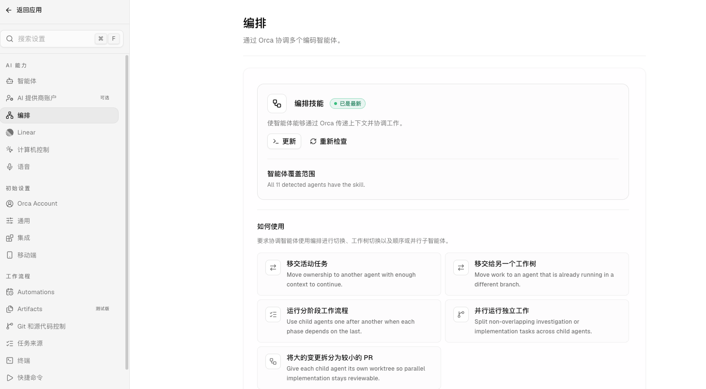
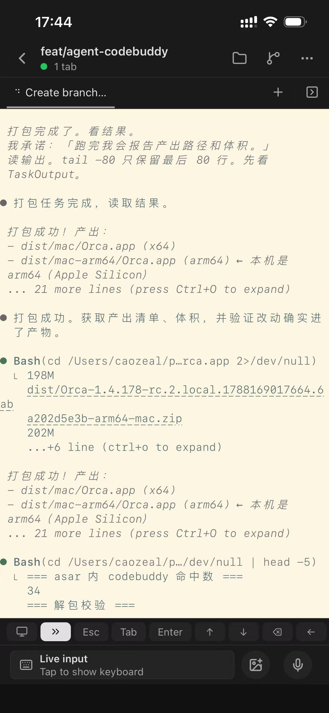
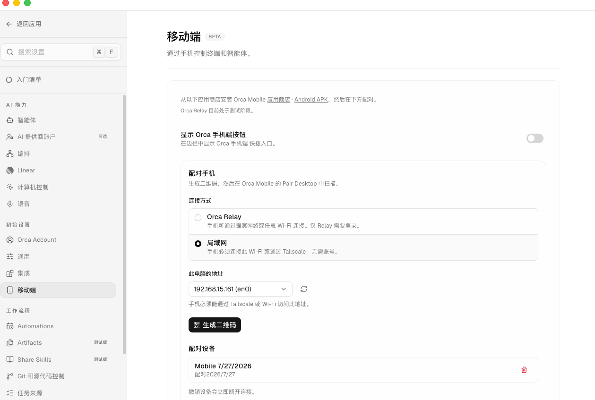
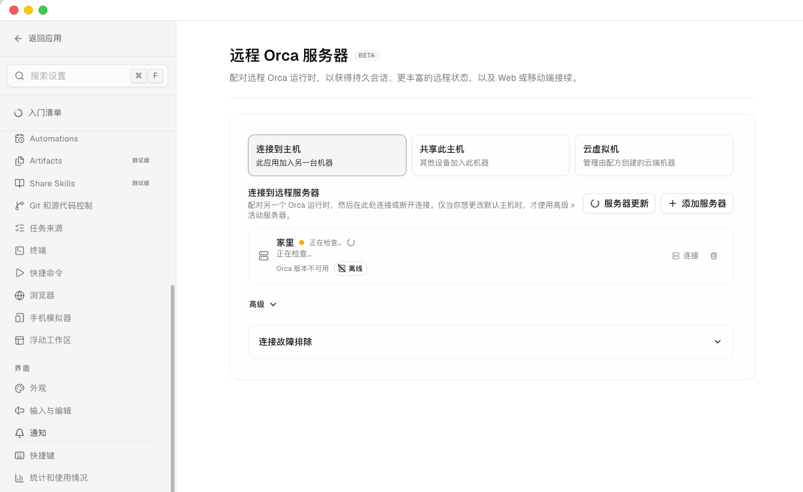
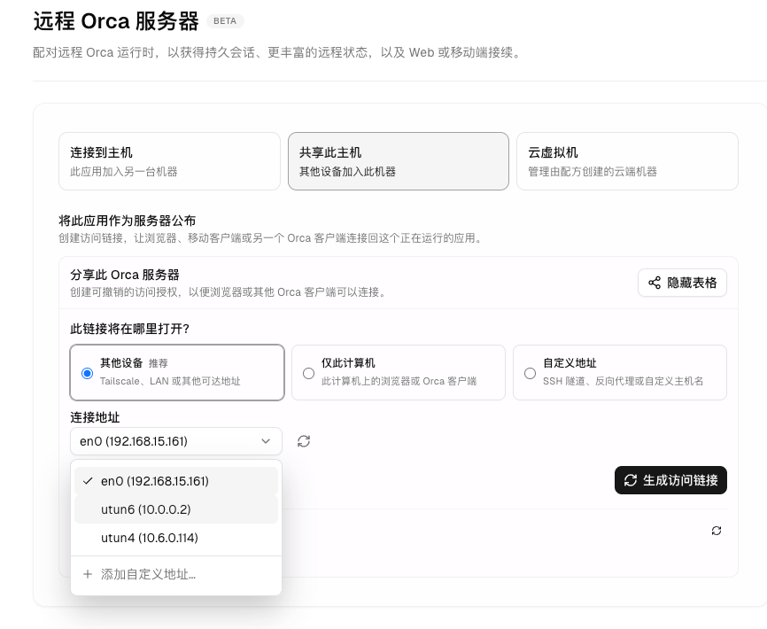

# 为什么我推荐 Orca？（二）

书接上文，这篇我们具体说下 Orca 的特色功能。

首先是吸引我来用它的一个功能：Agent 编排。

## 一、Agent 编排

Orca 的 Agent 编排能力是通过 Skill 方式实现的。很多 Agent 都具有编排能力，比如 Claude Code、CodeX 都可以通过 Sub Agent 或者 Agent Team 的方式来实现编排，但它们主打的是内部调用或次抛的使用方式，可观测性差了一些。



Orca 的编排则比较灵活，你可以使用 orchestration 模式，以 codex / claude code 起手，作为“架构师”，探讨需求，进行设计，设计完成后，来这么一句：

```
/orchestration 使用 omp 实现后端逻辑，kimi code 开发前端，grok 与 codex 进行审查和交叉测试
```

它就会主动在 Orca 窗口中调起多个 agent 来分步实现，依次或并行完成。

这种编排的好处：

- 一是可以使用昂贵但强大的模型作为设计者与审查员，具体细节实现交给稍弱但便宜的模型，一定程度节省开销；
- 二是，不同的 agent 与不同的模型交叉实现与审查，可以极大程度保证程序代码的可靠性；
- 三是这样可以利用不同 agent 与模型的优点，比如 gpt-5.6-sol 逻辑极强，但审美欠缺，kimi k3 审美优秀，但价格昂贵，dsf / glm-5.3-flash 能力稍弱，但速度极快。

更有把控感、也更有~~资本家~~视角的一种用法是，提前创建好多个 agent，按照角色命名为：项目负责人 / 架构师 / 后端工程师 / 前端工程师 / 测试 / 实习生，然后跟项目负责人沟通，开头先让其识别团队成员，后续任务按需分配即可。看着项目负责人往下分配任务，突然和资本家共情了，狠狠压榨团队成员。

除了 orchestration 模式，还可以在 codex / kimi 额度用完时，新起一个其他 agent 来随时接过任务：`/orchestration 查看当前项目另一个 codex 任务，接过继续实现`

## 二、移动端 Relay

OpenClaw 爆火的很重要的一点是，可以随时随地与本地 agent 进行交互了，通过 channel 连接三方聊天软件自然有其便利之处，但是完美展示执行步骤、提供完整交互这方面，还得看原生 app，Orca 移动终端提供了媲美原生 Agent 交互的体验。



我们可以在 App Store 中下载移动端 app，在设置中开启移动端 relay。我使用的时候还没有 Orca Relay 的选项，只能选择局域网，没有测试 Orca Relay 是否稳定，下面主要说一下局域网连接：

选择了这个之后，默认情况下，我们只能在局域网内进行连接访问，如何在路上 / 家里访问公司电脑的 Orca 呢？值得庆祝的是，现在有着多种多样的组网工具供我们选择，为我们创建一个虚拟的局域网来进行连接，网络环境好的可以选择 Tailscale，有服务器对安全性有要求的选择 WireGuard，国内的其他用户也可以选择节点小宝等等，大家可以自由探索交流。



## 三、远程 Orca 服务器

第一篇的时候，我把“远程 Orca 服务器、SSH、移动端 Relay”三项并列归到了“远程执行与指挥”这一条里，其实它们并不是一回事。上一节已经讲完移动端 Relay，这一节要说的是远程 Orca 服务器——而它和 SSH 又是最容易混淆的一组，我一开始也被绕晕过，索性先摆在一起对比清楚，再讲我自己的用法：

- **SSH 主机**：你电脑上的 Orca 是“主人”，远端机器是打工仔。Worktree、Agent 进程、终端实际都是拉远端执行的，但**会话的状态归你电脑管**——合上笔记本，Agent 也就停了。
- **远程 Orca 服务器**（下文简称“服务端”）：反过来。远端机器自己就是一个完整的 Orca 运行时，项目、Worktree、终端、Agent 进程全都跑在那台机器上，你的笔记本、手机、浏览器只是一个远程“显示器”。**笔记本关机，Agent 照样跑；第二天再打开，自动连回上次的会话**。

定位不一样，用法也就不一样。SSH 适合“借用远端算力干重活”，远程 Orca 服务器则适合“把整个工作台搬到一个常驻的地方”。



### 桌面 app + WireGuard

和移动端 relay 一样，配合组网工具，我们可以直接在常用的电脑上随时管理其他机器的 agent 任务。

大致步骤：

```
服务端机器：
  1. 装 Orca，配好 WireGuard，确认它在隧道里有个固定内网 IP（比如 10.0.0.2）
  2. 打开 设置 → 远程 Orca 服务器
  3. 在「将此应用作为服务器公布」下点「分享此 Orca 服务器」
  4. 「连接地址」下拉里选 WireGuard 网卡那个 utun 地址（比如 utun6 / 10.0.0.2）
     （默认列出来的是 LAN 的 en0 (192.168.x)，走 WireGuard 的话记得手动切到 utun 那条）
  5. 点「生成访问链接」，复制下面那串“Pair another Orca client”链接

客户端（你的主力笔记本）：
  1. 同样装好 Orca 和 WireGuard，先 ping 一下服务端的内网 IP 确认通了
  2. 设置 → 远程 Orca 服务器 → 添加服务器
  3. 起个好认的名字，把刚才那串链接粘进去
  4. 状态变成 已连接 就完事了
```



全程不用碰命令行，界面里点几下就完事。跑通之后最直观的区别是：晚上合盖回家，Agent 还在那台机器上接着干，第二天打开笔记本连回去，直接就是结果。

### 我自己的选择

最后说下我现在的部署：

- **服务端**：一台放在家里的旧 Mac mini，常年开机，桌面 app 直接挂在登录用户上，靠 WireGuard 隧道暴露出来。这台机器本来就接显示器，桌面端挂着管理起来最省事。
- **客户端**：主力 MacBook + iPhone。平时主力机出门带着，回家 / 在公司就通过服务端继续干同一件事；通勤或者躺床上用手机看一眼进度、必要时改个 prompt，体验比预期顺滑得多。
- **没用 SSH Worktree 模式**：服务端模式下，全局状态都在服务端，SSH 模式那种“远端只跑命令”的玩法对我来说反而成了多余的中间层。

对我来说 Orca 的价值不只是“多开了几个终端”，而是它把“Agent 的工作台”和“我手头这台设备”解耦开了——我可以今天在公司用 MacBook 接着昨天的会话，明天在地铁上用 iPhone 接着今天的会话，后天回到家里再接着同一件事往下走。Agent 还在那台 Mac mini 上跑着，我只是在不同屏幕上连回去。

## 四、最后

这三个功能说下来，其实都能归到同一件事上：把 Agent 从“某一台电脑上的某一次对话”里挪出来。

编排让它能同时驱动好几个 Agent，Relay 让手机也接得上，远程服务器让它在我关掉笔记本之后继续跑。听起来是三件事，用起来是一件事——我不用再操心任务具体跑在哪、跑到哪了，反正随时能接回去看。

另外也说句实话：Orca 更新非常快，几乎每天一个版本，这篇里提到的菜单名、选项名，过两周可能就变了。真要照着配，还是以你手上那版界面为准。
